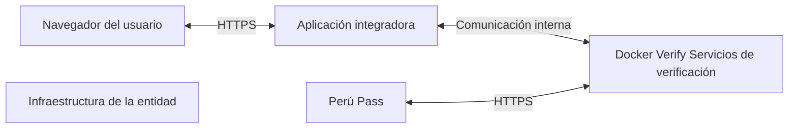

## **HÉCTOR EDUARDO SARAVIA MARTÍNEZ**

Director de Certificación
y Servicios Digitales

**REGISTRO NACIONAL DE IDENTIFICACIÓN Y ESTADO CIVIL**

Firmado digitalmente por:
**SARAVIA MARTÍNEZ** Hector Eduardo FAU 20295613620 hard
**Motivo:** En señal de conformidad
Fecha: 22/09/2026 10:55:57-0500

logo: República del Perú FIRMA DIGITAL

Firmado digitalmente por:
**MARTÍNEZ PANTA** Jorge Andres FAU 20295613620 soft
**Motivo:** Soy el autor del documento

## **CESAR ROBERTO ROSALES MAQUERA**

Sub Director de Servicios de Certificación Digital

**REGISTRO NACIONAL DE IDENTIFICACIÓN Y ESTADO CIVIL**

|  | Guía técnica |  |
| --- | --- | --- |
| VERSIÓN: 1.0 | CÓDIGO: DT-DCSD/SDSCD-035 |  |
| DIRECCIÓN: CERTIFICACIÓN Y SERVICIOS DIGITALES |  |  |
| SUB DIRECCIÓN: SERVICIOS DE CERTIFICACIÓN DIGITAL |  |  |
| Guía técnica: Habilitar la API de verificación del DNId en infraestructura gestionada por una entidad externa |  |  |
| CLASIFICACIÓN | PÚBLICA |  |
| RUBRO | NOMBRE | CARGO |
| ELABORADO POR | Jorge Andrés Martínez Panta | Especialista 1 |
| REVISADO POR | César Roberto Rosales Maquera | Subdirector de Servicios de Certificación Digital |
| APROBADO POR | Héctor Eduardo Saravia Martínez | Director de Certificación y Servicios Digitales |

Fecha: 21/09/2026 14:54:36-0500
Firmado digitalmente por:
**ROSALES MAQUERA** Cesar Roberto FAU 20295613620 soft
**Motivo:** Soy el autor del documento
Fecha: 22/09/2026 10:01:48-0500

## 1. **Contenido**

| 2. | Descripción general | 2 |
| --- | --- | --- |
| 3. | Datos de despliegue necesarios | 2 |
| 4. | Estructura de Archivos necesarios | 2 |
| 5. | Instalación de Docker | 3 |
| 6. | Habilitar e iniciar docker | 3 |
| 7. | Cargar imágenes docker | 3 |
| 8. | Configuración de parámetros de entorno | 4 |
| 9. | Ejecutar docker compose | 4 |
| 10. | Apertura de puertos firewall | 5 |
| 11. | Perfiles para solicitud de datos | 5 |
|  | DNI Titular — vct: DniPeruanoCredential | 5 |
|  | DNI Menor — vct: DniPeruanoMenorCredential | 6 |

<u>1</u>

## **2. Descripción general**

La presente guía describe el despliegue del módulo de verificación del DNI digital en infraestructura gestionada por la propia entidad verificadora. El servicio se implementa mediante una imagen Docker provista por RENIEC, que contiene las librerías, componentes y el plugin de verificación necesarios, permitiendo a la entidad controlar y proveer el servicio de verificación.

## **3. Datos de despliegue necesarios**

Los siguientes parámetros deben definirse de acuerdo con la integración que se realizará.

| PARÁMETRO | VALOR |
| --- | --- |
| Ruta de instalación | /opt/peru-pass-verify (ruta sugerida) |
| Puerto del servicio | 8081:8080 (puerto sugerido) |
| Imagen del backend | verify-service:latest |
| Imagen de la interfaz | verify-ui:latest |
| Imagen de PostgreSQL | postgres:13 |

Nota: El dominio debe configurarse de manera que el servicio Verify responda a través de HTTPS de forma obligatoria.

flow_chart: Arquitectura de la infraestructura de verificación



## **4. Estructura de Archivos necesarios**

Se entrega el paquete peru-pass-verify.tar.gz, que contiene todos los archivos necesarios para desplegar el servicio de verificación en la infraestructura de la entidad.

```text
/opt/peru-pass-verify/
├── config/
│   └── config.json
├── db-init/
│   └── init.sql
├── images/
│   ├── postgres-13.tar
│   ├── verify-service_latest.tar
│   └── verify-ui_latest.tar
├── install/
│   └── docker.rmps-rhell19.tar.gz
├── env.base
└── docker-compose.yml
```

2

## **5. Instalación de Docker**

Si ya se cuenta con una instalación de Docker se puede saltar este paso.

```bash
cd /opt/peru-pass-verify/install
```

### Desempaquetar los archivos necesarios

```bash
tar -zxvf docker.rmps-rhel19.tar.gz
```

### Instalar los paquetes desempaquetados

```bash
cd docker-rmps
dnf install -y ./*.*.rpm
```

### Verificación de versiones

```bash
docker --version
docker compose version
containerd --version
```

## **6. Habilitar e iniciar docker**

### Habilitar Docker para el inicio automático y arrancarlo inmediatamente:

```bash
systemctl enable --now docker
```

### Verificar:

```bash
systemctl status docker --no-pager
systemctl is-enabled docker
systemctl is-active docker
```

## **7. Cargar imágenes docker**

### Ingresar a la carpeta:

```bash
cd /opt/peru-pass-verify/images
```

### Cargar backend del servicio verify

```bash
docker load -i verify-service_latest.tar
```

### Cargar interfaz web

```bash
docker load -i verify-ui_latest.tar
```

### Cargar gestor de base de datos

```bash
docker load -i postgres-13.tar
```

3

## Verificar imágenes cargadas

```text
docker images
```

### Resultado esperado similar a

```text
IMAGE
dnid-verify-react:3.3.0
postgres:13
reniec-verify-service:0.0.1
```

## **8. Configuración de parámetros de entorno**

Dentro de la ruta de trabajo se encuentra el archivo *`.env.base`*. A partir de este archivo, debe crearse el archivo *`.env`* con los parámetros previamente definidos, los cuales se detallan a continuación:

```text
VITE_INJI_VERIFY_SERVICE_URL=<CAMBIAR: ...>
VITE_INJI_CLIENT_ID=<CAMBIAR: ...>
```

### A algo similar a

```text
VITE_INJI_VERIFY_SERVICE_URL=https://verify-demo.dominio.com/v1/verify
VITE_INJI_CLIENT_ID=did:web:verify-demo.dominio.com:v1:verify
```

Con los cambios realizados, se debe crear o ubicar el archivo ``.env`` en la misma ruta donde se encuentra el archivo ``docker-compose.yml``.

```text
/opt/peru-pass-verify/
├── config/
├── db-init/
├── images/
├── install/
├── .env
└── docker-compose.yml
```

## **9. Ejecutar docker compose**

### Desde la ruta del archivo compose

```text
cd /opt/peru-pass-verify
```

### Ejecutar el archivo compose

```text
docker compose up -d
```

### Verificar contenedores

4

```text
docker compose ps
```

## Seguimiento de logs

```text
docker compose logs -f
```

## 10. **Apertura de puertos firewall**

### Abrir el puerto TCP 8081 y 8082:

```text
firewall-cmd --permanent --add-port=8081/tcp
```

### Recargar

```text
firewall-cmd -reload
```

### Verificar

```text
firewall-cmd --list-ports
firewall-cmd --query-port=8081/tcp
```

## 11. **Perfiles para solicitud de datos**

Perfiles ya sembrados en db-init/init.sql (tabla presentation_definition) para tener un punto de partida fácil al armar un *POST /vp-request*, basta con pasar uno de estos IDs (texto libre, sin formato especial).

### **DNI Titular — vct: DniPeruanoCredential**

| ID | CAMPOS QUE PIDE |
| --- | --- |
| PERFIL-TITULAR-COMPLETO | Prenombres, CUI/DNI, Nacionalidad, Fecha de nacimiento, Sexo, Estado civil, Domicilio, Lugar de domicilio, Ubigeo de domicilio |
| PERFIL-TITULAR-BASICO | Prenombres, CUI/DNI |
| PERFIL-TITULAR-MINIMO | CUI/DNI |
| PERFIL-TITULAR-DIRECCION | CUI/DNI, Domicilio, Lugar de domicilio, Ubigeo de domicilio |
| PERFIL-TITULAR-ESTADO_CIVIL | CUI/DNI, Estado civil |
| PERFIL-TITULAR-NACIMIENTO | CUI/DNI, Fecha de nacimiento |
| PERFIL-TITULAR-NACIONALIDAD | CUI/DNI, Nacionalidad |

5

## **DNI Menor — vct: DniPeruanoMenorCredential**

**

| ID | CAMPOS QUE PIDE |
| --- | --- |
| PERFIL-MENOR-COMPLETO | Prenombres, CUI/DNI, Nacionalidad, Fecha de nacimiento, Sexo, Domicilio, Lugar de domicilio, Ubigeo de domicilio, Tipo y N° doc. progenitor 1, Tipo y N° doc. progenitor 2 |
| PERFIL-MENOR-BASICO | Prenombres, CUI/DNI |
| PERFIL-MENOR-MINIMO | CUI/DNI |
| PERFIL-MENOR-DIRECCION | CUI/DNI, Domicilio, Lugar de domicilio, Ubigeo de domicilio |
| PERFIL-MENOR-NACIMIENTO | CUI/DNI, Fecha de nacimiento |
| PERFIL-MENOR-NACIONALIDAD | CUI/DNI, Nacionalidad |
| PERFIL-MENOR-PROGENITORES | CUI/DNI, Tipo y N° doc. progenitor 1, Tipo y N° doc. progenitor 2 |
| PERFIL-MENOR-PROGENITOR1 | CUI/DNI, Tipo y N° doc. progenitor 1 |
| PERFIL-MENOR-PROGENITOR2 | CUI/DNI, Tipo y N° doc. progenitor 2 |

**

image: placeholder box

6