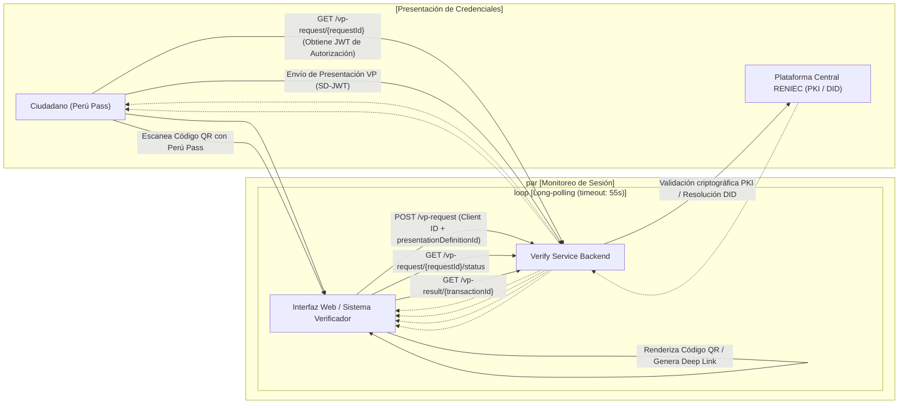

|  | Guía Técnica |  |
| --- | --- | --- |
| VERSIÓN: 1.0 | CÓDIGO: DT-DCSD/SDSCD-034 |  |
| DIRECCIÓN: CERTIFICACIÓN Y SERVICIOS DIGITALES |  |  |
| SUB DIRECCIÓN: SERVICIOS DE CERTIFICACIÓN DIGITAL |  |  |
| Guía técnica: API disponible de verificación del DNId |  |  |
| CLASIFICACIÓN | PÚBLICA |  |
| RUBRO | NOMBRE | CARGO |
| ELABORADO POR | Jorge Andrés Martínez Panta | Especialista 1 |
| REVISADO POR | César Roberto Rosales Maquera | Subdirector de Servicios de Certificación Digital |
| APROBADO POR | Héctor Eduardo Saravia Martínez | Director de Certificación y Servicios Digitales |

| HÉCTOR EDUARDO SARAVIA MARTÍNEZ Director de Certificación y Servicios Digitales REGISTRO NACIONAL DE IDENTIFICACIÓN Y ESTADO CIVIL | Firmado digitalmente por: SARAVIA MARTÍNEZ Hector Eduardo FAU 20295613620 hard Motivo: En señal de conformidad Fecha: 22/09/2026 10:56:25-0500 |
| --- | --- |

| logo: República del Perú FIRMA DIGITAL | Firmado digitalmente por: MARTÍNEZ PANTA Jorge Andres FAU 20295613620 soft Motivo: Soy el autor del documento Fecha: 21/09/2026 14:54:18-0500 | CESAR ROBERTO ROSALES MAQUERA Sub Director de Servicios de Certificación Digital REGISTRO NACIONAL DE IDENTIFICACIÓN Y ESTADO CIVIL | Firmado digitalmente por: ROSALES MAQUERA Cesar Roberto FAU 20295613620 soft Motivo: Soy el autor del documento Fecha: 22/09/2026 10:01:31-0500 | 0 |
| --- | --- | --- | --- | --- |

## **Contenido**

| 1. | Descripción general | 2 |
| --- | --- | --- |
| 2. | Requisitos técnicos previos | 2 |
| 3. | Catálogo de endpoints | 2 |
| 4. | Flujo para realizar una verificación de credenciales | 2 |
| 4.1. | Diagrama de secuencia | 2 |
| 4.2. | Pasos para la integración de la verificación | 3 |
|  | Paso 1: Inicio de sesión – POST/vp-request | 3 |
|  | Paso 2: Construcción del enlace para abrir Perú Pass | 3 |
|  | Paso 3: Consulta de estado mediante long polling – GET /vprequest/{requestId}/status | 4 |
|  | Paso 4: Obtener resultado final – GET /vp-result/{transactionId} | 5 |
|  | Paso 5: Extraer los datos de la credencial (SD-JWT) | 5 |
| 5. | Validación de credenciales (Carga de la prueba) | 6 |

<u>1</u>

## **1. Descripción general**

Esta guía explica cómo integrar el verificador del DNI digital (DNIId) de RENIEC mediante su API. Describe los endpoints necesarios para completar el flujo de verificación de credenciales e incluye, para cada uno, su finalidad, los parámetros requeridos, un ejemplo de uso con curl y la respuesta esperada. La integración puede realizarse desde cualquier lenguaje de programación o tecnología que permita consumir servicios HTTP.

## **2. Requisitos técnicos previos**

Antes de iniciar la integración, se deberá contar con la información necesaria para consumir el servicio y ejecutar verificaciones basadas en las presentaciones previamente configuradas.

| PARÁMETRO | VALOR |
| --- | --- |
| URL base del servicio | https://verify.inji-reniec.com/v1/verify |
| Client ID o Identificador DID del verificador | did:web:verify.inji-reniec.com:v1:verify |
| Perfil de datos 1 | b2c3d4e5-f6a7-8901-bcde-f12345678901 |
| Perfil de datos 2 | c3d4e5f6-a7b8-9012-cdef-123456789012 |

**Nota:** Los perfiles de datos definen qué información se solicitará al usuario durante la presentación de su DNIId.

## **3. Catálogo de endpoints**

A continuación, se describen los endpoints necesarios para ejecutar satisfactoriamente el flujo de verificación de una credencial.

| MÉTODO | RUTA | USO |
| --- | --- | --- |
| POST | /vp-request | Crear solicitud de VP (inicia el flujo OpenID4VP) |
| GET | /vp-request/{requestId}/status | Long-polling del estado de la solicitud |
| GET | /vp-result/{transactionId} | Resultado final de la presentación VP |
| POST | /vc-verification | Verificar VC directamente sin flujo VP |

## **4. Flujo para realizar una verificación de credenciales**

En esta sección se describen, en orden de uso, los endpoints necesarios para completar el flujo de verificación. Para realizar el proceso, se necesita un dispositivo móvil con la aplicación Perú Pass instalada y actualizada, y una credencial verificable válida almacenada en ella.

### **4.1. Diagrama de secuencia**

Ver anexo 01

2

## **4.2. Pasos para la integración de la verificación**

### Paso 1: Inicio de sesión – POST/vp-request

Inicia el flujo OpenID4VP y genera los parámetros necesarios para dar seguimiento a la verificación y obtener su resultado final.

```text
curl -s -X POST "https://verify.inji-reniec.com/v1/verify/vp-request" -H
"Content-Type: application/json" -d "{\"clientId\":\"did:web:verify.inji-reniec.com:v1:verify\",\"presentationDefinitionId\":\"b2c3d4e5-f6a7-8901-bcde-f12345678901\"}"
```

| PARÁMETRO | DESCRIPCIÓN |
| --- | --- |
| clientId | Identificador del verificador que solicita la presentación del DNId, se utiliza el formato did:web. |
| presentationDefinitionId | Identificador del perfil de datos que define qué información se solicitará para la verificación. |

#### Respuesta esperada

```json
{
  "transactionId": "txn_68851035-db49-4860-890f-4362df268a76",
  "requestId": "req_5ccc0964-6b08-4ecf-b869-93049fc95ce2",
  "expiresAt": 1783015304454,
  "requestUri": "https://verify.inji-reniec.com/v1/verify/vp-request/req_5ccc0964-6b08-4ecf-b869-93049fc95ce2"
}
```

| PARÁMETRO | DESCRIPCIÓN |
| --- | --- |
| transactionId | Identificador de la transacción de verificación iniciada. |
| requestId | Identificador de la solicitud, utilizado para consultar su estado. |
| expiresAt | Fecha y hora en que vence la solicitud de verificación. |
| requestUri | URL que permite a Perú Pass obtener la solicitud de verificación y se utiliza para construir el código QR. |

### Paso 2: Construcción del enlace para abrir Perú Pass

Para abrir la aplicación Perú Pass e iniciar la presentación del DNId, se debe construir un enlace siguiendo el procedimiento y utilizando los parámetros que se detallan a continuación.

1. Utilizar como base:

```text
openid4vp://authorize
```

2. Codifica el valor de *client_id* mediante percent-encoding:

```text
client_id=did%3Aweb%3Averify.inji-reniec.com%3A<sub>v1</sub>%3Averify
```

3

3. Codifica el valor de *requestUri* mediante percent-encoding:

```text
https%3A%2F%2Fverify.inji-reniec.com%2Fv1%2Fverify%2Fvp-
request%2Freq_5ccc0964-6b08-4ecf-b869-93049fc95ce2
```

4. Unir ambos resultados con la base:

```text
openid4vp://authorize?client_id=did%3Aweb%3Averify.inji-reniec.com%3Av1%3Averify&request_uri=https%3A%2F%2Fverify.inji-reniec.com%2Fv1%2Fverify%2Fvp-request%2Freq_5ccc0964-6b08-4ecf-b869-93049fc95ce2
```

El enlace construido puede utilizarse de dos formas:

* **Mediante código QR:** Se genera un QR con el enlace para que el usuario lo escanee desde la aplicación Perú Pass y continúe con la verificación.
* **Mediante enlace directo desde un navegador o una aplicación móvil:** Se abre la aplicación Perú Pass usando este enlace en el mismo dispositivo para continuar con la verificación, sin escanear un QR.

## Interacción con la aplicación Perú Pass

Al escanear el QR o abrir el enlace directo, el usuario podrá seleccionar en Perú Pass las credenciales y la información que desea compartir. La verificación permanecerá pendiente hasta que complete la operación. Durante este proceso, se podrá consultar el estado mediante *long polling* en el endpoint */*status*.

### Paso 3: Consulta de estado mediante long polling – GET /vp-request/{requestId}/status

Permite consultar el estado de la verificación utilizando el requestId obtenido en el paso 1. El servicio mantiene cada consulta abierta hasta que se produzca una actualización o se cumplan 55 segundos de espera.

```text
curl -s "https://verify.inji-reniec.com/v1/verify/vp-request/req_5ccc0964-6b08-4ecf-b869-93049fc95ce2/status"
```

### *Respuestas posibles*

Pendiente de escaneo / autorización:

```json
{
  "status": "ACTIVE"
}
```

Sesión expirada:

```json
{
  "status": "EXPIRED"
}
```

4

**Error controlado:**

```json
{
  "errorCode": "NO_AUTH_REQUEST",
  "errorMessage": "No Authorization request found for given request ID."
}
```

**Credencial entregada exitosamente (Habilita la consulta del resultado final):**

```json
{
  "status": "VP_SUBMITTED"
}
```

## Paso 4: Obtener resultado final – GET /vp-result/{transactionId}

Cuando el estado sea *VP_SUBMITTED*, la presentación de la credencial habrá sido recibida y se podrá consultar el resultado de la verificación mediante este endpoint, utilizando el parametro *transactionId* obtenido en el paso 1.

```text
curl -s "https://verify.inji-reniec.com/v1/verify/vp-result/txn_68851035-db49-4860-890f-4362df268a76"
```

### Respuesta esperada

```json
{
  "transactionId": "txn_68851035-db49-4860-890f-4362df268a76",
  "vpResultStatus": "SUCCESS",
  "vcResults": [
    {
      "vc": "eyJ4NXQjUz...hDekF",  //Credencial verificable
      "verificationStatus": "SUCCESS"
    }
  ]
}
```

| PARÁMETRO | DESCRIPCIÓN |
| --- | --- |
| transactionId | Identificador de la transacción de verificación iniciada. |
| vpResultStatus | Estado general del resultado de la verificación. |
| vcResults | Resultados de la verificación de las credenciales. |
| vcResults:vc | Contenido de la credencial evaluada. |
| vcResults :verificationStatus | Estado de verificación de la credencial recibida. |

## Paso 5: Extraer los datos de la credencial (SD-JWT)

El campo *vc* obtenido en el paso 4 contiene la credencial en formato *SD-JWT*, que permite compartir únicamente los datos seleccionados por el usuario.

Su contenido se divide en segmentos separados por el carácter ~:

```text
<JWT del emisor>~<Datos compartidos>~...~<JWT de vinculación opcional>
```

5

* **JWT del emisor**: Contiene información de la credencial, referencias para validar los datos compartidos y la firma digital del emisor.
* **Datos compartidos**: Contienen los atributos que el usuario autorizó compartir, codificados en Base64URL. Para campos como los siguientes, cada segmento se decodifica como [sal, nombre del campo, valor]. La sal es un valor aleatorio utilizado para proteger el dato.
* **JWT de vinculación**: Permite comprobar que quien presenta la credencial controla la clave privada asociada a ella y que la credencial y los datos compartidos no han sido alterados. Por ejemplo, al decodificar los datos compartidos:

```text
["sal_aleatoria_1", "CUI_DNI", "47291038"]
["sal_aleatoria_2", "PRENOMBRES", "JUAN CARLOS"]
```

Una vez confirmado que la verificación fue satisfactoria, el sistema podrá extraer y guardar los campos necesarios. Decodificar los datos no sustituye la validación de la credencial.

## **5. Validación de credenciales (Carga de la prueba)**

Una credencial almacenada puede volver a validarse cuando sea necesario. Para ello, envíe a este endpoint el *SD-JWT* completo obtenido del campo *vc* de la respuesta de `/vp-result/{transactionId}`, como texto, sin modificarlo ni agregar contenido adicional.

```text
curl -s -X POST "https://verify.inji-reniec.com/v1/verify/vc-verification" -H "Content-Type: application/vc+sd-jwt" -d "eyJ4NXQjUz...hDekF"
```

### *Respuestas posibles*

#### Revalidación conforme

```json
{
    "verificationStatus": "SUCCESS"
}
```

#### Revalidación con errores

```json
{
    "verificationStatus": "INVALID"
}
```

6

## **<u>Anexo 01: Diagrama de secuencia</u>**

flow_chart: sequence diagram of Peru Pass verification process



7