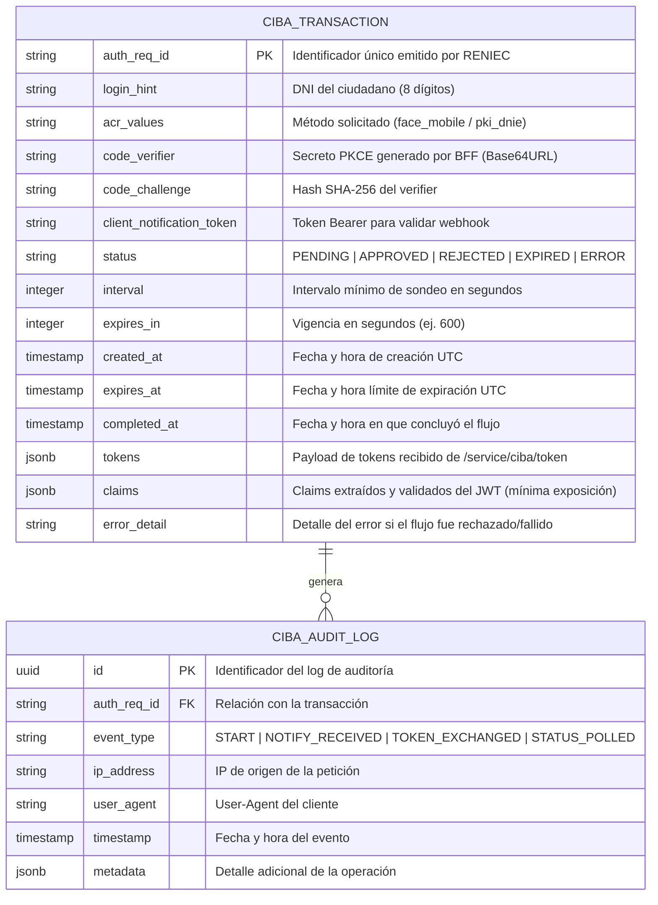

# ESPECIFICACIÓN TÉCNICA DE PERSISTENCIA Y MODELO TRANSACCIONAL
## Arquitectura de Datos para el Flujo CIBA + PKCE ID-Perú (RENIEC)
### Santander Perú · BFF (Backend For Frontend)

---

| Metadato | Detalle |
| :--- | :--- |
| **Versión** | 1.0 |
| **Fecha** | Octubre 2026 |
| **Módulo** | Persistencia Transaccional CIBA · Santander BFF |
| **Motor de BD Sugerido** | PostgreSQL 15+ / Redis (Caché transaccional) |
| **ORM / Acceso a Datos** | SQLAlchemy 2.0+ / SQLModel con Pydantic v2 |
| **Estado** | Aprobado |

---

## 1. OBJETIVO DEL DOCUMENTO

Especificar el diseño técnico, el modelo de datos relacional y las operaciones del ciclo de vida de la transacción CIBA en el BFF de Santander, dando cumplimiento estricto a las 4 razones normativas y de arquitectura descritas en la **Sección 8.1.3 ("Resguardo de la transacción en el BFF")** y **Sección 10 ("Consideraciones Técnicas Generales")** de la documentación oficial ID-Perú CIBA v1.3:

1. **Desacoplamiento e Inexistencia de Sesión en el Webhook:** La llamada a `url_notify` no posee sesión de usuario.
2. **Resguardo Obligatorio de Parámetros Criptográficos:** Almacenamiento seguro de `code_verifier`, `client_notification_token` y `auth_req_id`.
3. **Consumo de Resultado Único (One-Time Token):** RENIEC solo emite `access_token` e `id_token` una vez y destruye el `auth_req_id`.
4. **Alta Disponibilidad y Concurrencia Multi-Instancia:** Soporte para balanceadores de carga (Instancia A procesa `/start`, Instancia B procesa `/notify`).

---

## 2. MODELO ENTIDAD-RELACIÓN (MER)



---

## 3. ESQUEMA DDL SQL (POSTGRESQL)

```sql
-- Creación de la tabla principal de transacciones CIBA
CREATE TABLE IF NOT EXISTS ciba_transactions (
    auth_req_id VARCHAR(255) PRIMARY KEY,
    login_hint VARCHAR(8) NOT NULL,
    acr_values VARCHAR(32) NOT NULL,
    code_verifier VARCHAR(128) NOT NULL,
    code_challenge VARCHAR(128) NOT NULL,
    client_notification_token VARCHAR(128) NOT NULL,
    status VARCHAR(20) NOT NULL DEFAULT 'PENDING',
    interval INT NOT NULL DEFAULT 5,
    expires_in INT NOT NULL DEFAULT 600,
    created_at TIMESTAMP WITH TIME ZONE NOT NULL DEFAULT CURRENT_TIMESTAMP,
    expires_at TIMESTAMP WITH TIME ZONE NOT NULL,
    completed_at TIMESTAMP WITH TIME ZONE NULL,
    tokens JSONB NULL,
    claims JSONB NULL,
    error_detail TEXT NULL
);

-- Índices para optimización de consultas por token y estado
CREATE INDEX IF NOT EXISTS idx_ciba_tx_client_notif_token ON ciba_transactions(client_notification_token);
CREATE INDEX IF NOT EXISTS idx_ciba_tx_status ON ciba_transactions(status);
CREATE INDEX IF NOT EXISTS idx_ciba_tx_expires_at ON ciba_transactions(expires_at);

-- Tabla de auditoría bancaria
CREATE TABLE IF NOT EXISTS ciba_audit_logs (
    id UUID PRIMARY KEY DEFAULT gen_random_uuid(),
    auth_req_id VARCHAR(255) NOT NULL REFERENCES ciba_transactions(auth_req_id) ON DELETE CASCADE,
    event_type VARCHAR(50) NOT NULL,
    ip_address VARCHAR(45) NULL,
    user_agent TEXT NULL,
    timestamp TIMESTAMP WITH TIME ZONE NOT NULL DEFAULT CURRENT_TIMESTAMP,
    metadata JSONB NULL
);

CREATE INDEX IF NOT EXISTS idx_ciba_audit_tx ON ciba_audit_logs(auth_req_id);
```

---

## 4. MODELO DE CLASES EN PYTHON (SQLModel / SQLAlchemy)

Archivo de referencia: `bff/core/database/models.py`

```python
from datetime import datetime, timezone
from typing import Optional
from sqlmodel import SQLModel, Field, Column, JSON


class CibaTransaction(SQLModel, table=True):
    __tablename__ = "ciba_transactions"

    auth_req_id: str = Field(primary_key=True, index=True, max_length=255)
    login_hint: str = Field(index=True, max_length=8)
    acr_values: str = Field(max_length=32)
    
    # Secretos criptográficos (Punto 2)
    code_verifier: str = Field(max_length=128)
    code_challenge: str = Field(max_length=128)
    client_notification_token: str = Field(index=True, max_length=128)
    
    # Máquina de estados
    status: str = Field(default="PENDING", index=True, max_length=20)
    interval: int = Field(default=5)
    expires_in: int = Field(default=600)
    
    created_at: datetime = Field(default_factory=lambda: datetime.now(timezone.utc))
    expires_at: datetime = Field(index=True)
    completed_at: Optional[datetime] = Field(default=None)
    
    # Resguardo de resultado único (Punto 3)
    tokens: Optional[dict] = Field(default=None, sa_column=Column(JSON))
    claims: Optional[dict] = Field(default=None, sa_column=Column(JSON))
    error_detail: Optional[str] = Field(default=None)
```

---

## 5. REGLAS DE NEGOCIO PARA LOS 4 PUNTOS DE PERSISTENCIA

### 5.1. Implementación del Punto 1: Desacoplamiento sin Sesión en el Webhook
* **Problema:** La petición `POST /api/auth/notify` llega desde los servidores de RENIEC; no contiene cookies, JWT de sesión de usuario ni contexto del navegador.
* **Solución de Persistencia:**
  ```python
  # El BFF localiza la transacción únicamente con el auth_req_id del payload de RENIEC
  stmt = select(CibaTransaction).where(CibaTransaction.auth_req_id == payload.auth_req_id)
  tx = session.exec(stmt).first()
  if not tx:
      raise HTTPException(status_code=404, detail="Transacción inexistente o vencida")
  ```

### 5.2. Implementación del Punto 2: Resguardo Criptográfico (PKCE y Bearer)
* **`client_notification_token`:** Se recupera de la base de datos para comparar contra el encabezado entrante de RENIEC:
  ```python
  if not hmac.compare_digest(tx.client_notification_token, incoming_bearer_token):
      raise HTTPException(status_code=401, detail="Token no autorizado")
  ```
* **`code_verifier`:** Se extrae del registro para consumar la petición `/service/ciba/token` con el secreto asociado.

### 5.3. Implementación del Punto 3: Resguardo del Resultado Único (One-Time Token)
* **Regla:** RENIEC invalida el `auth_req_id` inmediatamente después del primer canje en `/service/ciba/token`.
* **Solución de Persistencia:**
  * El BFF ejecuta el intercambio **una sola vez**.
  * Guarda el JSON de respuesta (`tokens`) y los atributos verificados (`claims`) dentro de los campos `tokens` y `claims` de la fila en PostgreSQL.
  * Cuando el frontend vuelve a consultar (`GET /api/auth/{id}/status`), el BFF lee de su propia base de datos; **nunca vuelve a consultar a RENIEC**, evitando el error `20008: auth_req_id no encontrado`.

### 5.4. Implementación del Punto 4: Soporte para Múltiples Réplicas (Cluster / Kubernetes)
* **Arquitectura sin Estado (Stateless Application Servers):**
  * Al mover las transacciones de la memoria RAM local (`transacciones_db = {}`) a PostgreSQL o Redis centralizado:
    * El usuario puede invocar `/api/auth/start` en la réplica **BFF Pod 1**.
    * RENIEC puede enviar el webhook `/api/auth/notify` a la réplica **BFF Pod 2**.
    * El navegador del usuario puede consultar el polling `/status` en la réplica **BFF Pod 3**.
  * Todas las réplicas comparten el mismo estado consistente y sincronizado.

---

## 6. POLÍTICA DE LIMPIEZA Y RETENCIÓN DE DATOS (Data Retention)

Para cumplir con la Ley de Protección de Datos Personales (Ley N° 29733) y optimizar el rendimiento:
1. **Transacciones Expiradas sin Concluir:** Un proceso batch o cron diario elimina o archiva transacciones en estado `PENDING` o `EXPIRED` con más de 24 horas de antigüedad.
2. **Tokens Sensibles:** El `access_token` e `id_token` completos pueden expirar y limpiarse tras 7 días; los claims básicos y logs de auditoría se conservan según la política de retención del banco.
