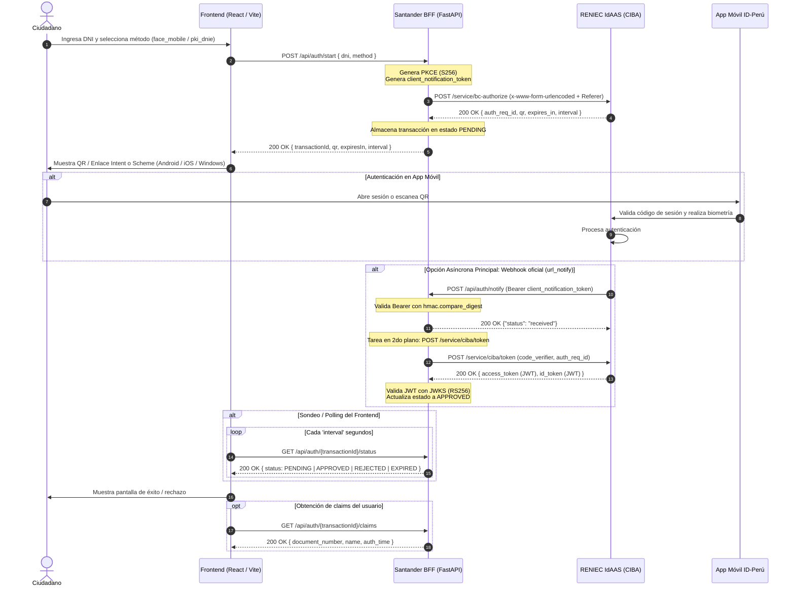

# ESPECIFICACIÓN TÉCNICA DE INTEGRACIÓN
## Autenticación CIBA (OpenID Connect Client-Initiated Backchannel Authentication) + PKCE
### Santander Perú · Plataforma ID-Perú (RENIEC)

---

| Metadato | Detalle |
| :--- | :--- |
| **Versión** | 1.3 |
| **Fecha** | Octubre 2026 |
| **Estado** | Aprobado / Implementado |
| **Arquitectura** | Backend For Frontend (BFF) + Frontend React/Vite |
| **Estándares** | OpenID Connect CIBA Core 1.0, RFC 7636 (PKCE), RFC 7517 (JWKS), RFC 7519 (JWT) |

---

## 1. OBJETIVO DEL DOCUMENTO

Definir la arquitectura, el diseño técnico, los contratos de API y las reglas de negocio para la integración entre la plataforma digital de **Banco Santander Perú** y la plataforma de autenticación **ID-Perú (RENIEC IdAAS)**, desacoplando la lógica sensible a través de un servicio **Backend For Frontend (BFF)**.

---

## 2. ARQUITECTURA DE LA SOLUCIÓN

La arquitectura adoptada es **BFF (Backend For Frontend)**. Este patrón garantiza:
1. **Protección de Credenciales:** El `client_id` y `client_secret` asignados por RENIEC residen exclusivamente en el servidor (BFF) y nunca se exponen al navegador o cliente móvil.
2. **Aislamiento Criptográfico:** La generación de PKCE (`code_verifier` / `code_challenge`), tokens de correlación (`client_notification_token`) y la validación de firmas JWT se procesan de forma centralizada.
3. **Desacoplamiento del Frontend:** El frontend integrador interactúa únicamente con el BFF; no tiene conectividad directa con la infraestructura interna de RENIEC.



---

## 3. ESPECIFICACIÓN TÉCNICA DEL BFF

### 3.1. Parámetros de Configuración y Seguridad
* **`RENIEC_BASE_URL`**: `https://idaas2.reniec.gob.pe`
* **`RENIEC_CLIENT_ID`**: Identificador asignado por RENIEC a Santander.
* **`RENIEC_CLIENT_SECRET`**: Secreto de cliente.
* **`RENIEC_REFERER`**: Cabecera obligatoria `santander.com.pe` para evitar bloqueos del cerco de seguridad (WAF) de RENIEC.
* **`URL_NOTIFY`**: Endpoint público registrado ante RENIEC al que se notifica la finalización.

### 3.2. Mecanismo de Seguridad PKCE (RFC 7636)
* **`code_verifier`**: Cadena criptográficamente aleatoria generada con 64 bytes de entropía (`os.urandom(64)`), codificada en **Base64URL sin relleno** (`=`). Longitud: ~86 caracteres (cumple con la cota de 43 a 128 permitidos).
* **`code_challenge`**: Hash binario `SHA-256` del `code_verifier`, codificado en **Base64URL sin relleno**.
* **`code_challenge_method`**: `"S256"`.

### 3.3. Token de Notificación (`client_notification_token`)
Cadena aleatoria de 256 bits generada por el BFF para cada transacción. ID-Perú lo devuelve en el encabezado `Authorization: Bearer <token>` al invocar el webhook. Se valida mediante comparación en tiempo constante (`hmac.compare_digest`) para mitigar ataques de temporización.

---

## 4. CATÁLOGO DE ENDPOINTS DEL BFF

### 4.1. Iniciar Autenticación
* **Ruta:** `POST /api/auth/start`
* **Descripción:** Valida los datos iniciales, genera PKCE y solicita a RENIEC la creación de la sesión CIBA.
* **Request Body:**
  ```json
  {
    "dni": "12345678",
    "method": "face_mobile",
    "binding_message": "Autenticación Santander"
  }
  ```
* **Response Body (200 OK):**
  ```json
  {
    "auth_req_id": "RENIEC_IDAAS.B-998877...-Ciba",
    "qr": "UkVOSUVDIENsYX...==",
    "expires_in": 600,
    "interval": 5,
    "transactionId": "RENIEC_IDAAS.B-998877...-Ciba",
    "expiresIn": 600,
    "message": "Transacción iniciada con éxito"
  }
  ```

---

### 4.2. Webhook Callback (url_notify de RENIEC)
* **Ruta:** `POST /api/auth/notify`
* **Descripción:** Notificación asíncrona enviada por la plataforma ID-Perú al concluir la validación del ciudadano.
* **Cabecera requerida:** `Authorization: Bearer <client_notification_token>`
* **Request Body:**
  ```json
  {
    "auth_req_id": "RENIEC_IDAAS.B-998877...-Ciba",
    "status": "completed"
  }
  ```
* **Response Body (200 OK):**
  ```json
  {
    "status": "received"
  }
  ```

---

### 4.3. Consulta de Estado (Polling)
* **Rutas:** 
  * `GET /api/auth/{transactionId}/status`
  * `GET /api/auth/status?auth_req_id={transactionId}`
* **Descripción:** Endpoint consumido por el navegador del usuario para conocer el estado actual de la operación sin consultar a RENIEC directamente.
* **Response Body (200 OK):**
  ```json
  {
    "auth_req_id": "RENIEC_IDAAS.B-998877...-Ciba",
    "transactionId": "RENIEC_IDAAS.B-998877...-Ciba",
    "status": "APPROVED",
    "message": "Autenticación completada exitosamente.",
    "claims": {
      "document_number": "12345678",
      "name": "JUAN PEREZ",
      "auth_time": 1771548958
    }
  }
  ```
  *Valores posibles de `status`: `PENDING`, `APPROVED`, `REJECTED`, `EXPIRED`, `ERROR`.*

---

### 4.4. Obtención de Claims (Mínima Exposición)
* **Ruta:** `GET /api/auth/{transactionId}/claims`
* **Descripción:** Retorna únicamente la información de identidad necesaria para el negocio del banco tras una autenticación exitosa.
* **Response Body (200 OK):**
  ```json
  {
    "document_number": "12345678",
    "name": "JUAN PEREZ",
    "given_name": "JUAN",
    "auth_time": 1771548958,
    "sub": "b773d1...c4ff6508"
  }
  ```

---

### 4.5. Canje de Tokens
* **Ruta:** `POST /api/auth/token?auth_req_id={transactionId}`
* **Descripción:** Intercambia el `auth_req_id` y el `code_verifier` ante `/service/ciba/token` de RENIEC y devuelve los JWT validados.

---

## 5. ESPECIFICACIÓN TÉCNICA DEL FRONTEND

El frontend adapta dinámicamente la experiencia del usuario según el canal y el dispositivo:

### 5.1. Canales de Invocación de la App ID-Perú
1. **Navegador Web Desktop (Computadora):**
   * Muestra el código QR como imagen vectorial SVG (240x240 px) para escaneo con la app móvil.
   * Dispone del esquema `idaas2://launch?data={qr}` para clientes con lector DNIe en Windows 10/11.
2. **Navegador Web Móvil (Android):**
   * Ofrece apertura directa vía Android Intent:
     ```text
     intent://idaas.reniec.com/auth/#Intent;scheme=reniec;package=pe.gob.reniec.pki.reniecidaas2;S.name=ID%20Per%C3%BA;S.data={qr};end
     ```
3. **Navegador Web Móvil (iOS):**
   * Ofrece apertura directa vía URL Scheme:
     ```text
     reniecidaas://auth?data={qr_urlencoded}
     ```

### 5.2. Reglas de Control de Sondeo (Anti Rate-Limiting)
* El sondeo periódico hacia `/api/auth/{transactionId}/status` respeta estrictamente el campo `interval` (mínimo 5 segundos).
* Se incluye el mecanismo de confirmación manual mediante el botón *"Ya me autentiqué en mi celular"* para forzar una consulta única de respaldo.

---

## 6. VALIDACIÓN CRIPTOGRÁFICA DE JWT

El BFF valida los tokens emitidos por ID-Perú siguiendo estas reglas:
1. **Algoritmo:** Únicamente `RS256` (rechazando tokens con algoritmo `none` o asimétricos no autorizados).
2. **JWKS:** Descarga de claves públicas desde `https://idaas2.reniec.gob.pe/service/jwks` con caché local de 15 minutos (900 segundos).
3. **Firma:** Verificación de la firma RSA con el `kid` correspondiente al header del JWT.
4. **Claims Obligatorios:**
   * `exp > now`: Token vigente.
   * `azp == RENIEC_CLIENT_ID`: Token emitido para Santander.
   * `document_number == login_hint`: Identidad coincidente con la solicitada en el inicio.

---

## 7. MATRIZ DE CÓDIGOS DE ERROR DE ID-PERÚ

| Código | Tipo | Mensaje | Causa | Acción BFF / Frontend |
| :---: | :---: | :--- | :--- | :--- |
| `10005` | `server_error` | CIBA: scope requerido | No se envió `scope=openid` en `/bc-authorize` | Corregir payload en backend |
| `10007` | `server_error` | CIBA: login_hint requerido | DNI ausente o vacío | Validar entrada en frontend |
| `10011` | `server_error` | CIBA: code_challenge requerido | Falta parámetro PKCE | Generar y enviar PKCE |
| `20001` | `server_warn` | Autenticación pendiente | El ciudadano no ha completado el flujo en su celular | Mantener estado `PENDING` |
| `20009` | `server_error` | CIBA: auth_req_id expirado | Transacción superó vigencia | Pasar estado a `EXPIRED` |
| `60001` | `mobile_error` | invalid_qr | Código QR inválido o expirado | Solicitar nueva transacción |
| `60007` | `mobile_error` | facial_attempts_exceeded | Intentos biométricos agotados | Notificar al usuario para reintento |
| `60008` | `mobile_error` | dnie_blocked | DNIe bloqueado | Indicar trámite presencial en RENIEC |
