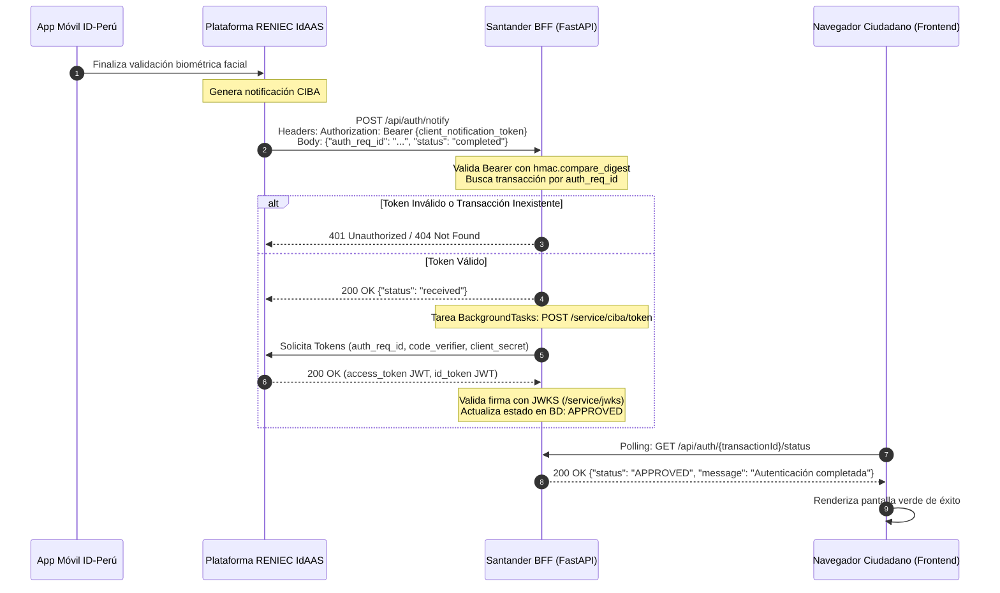

# GUÍA TÉCNICA DE CONFIGURACIÓN Y DESPLIEGUE DE AMBIENTES
## Variables de Entorno, Credenciales y Webhook de Notificaciones ID-Perú (RENIEC)
### Santander Perú · Arquitectura BFF

---

| Metadato | Detalle |
| :--- | :--- |
| **Versión** | 1.0 |
| **Fecha** | Octubre 2026 |
| **Área** | Canales Digitales / Arquitectura de Seguridad |
| **Módulo** | BFF Santander (`bff/`) · Plataforma RENIEC IdAAS CIBA |
| **Estado** | Aprobado |

---

## 1. PROPÓSITO DEL DOCUMENTO

Esta especificación describe:
1. La arquitectura de almacenamiento y carga de variables de entorno y secretos del BFF.
2. El catálogo exhaustivo de variables técnicas requeridas para la integración con la plataforma ID-Perú de RENIEC.
3. El funcionamiento detallado del endpoint Webhook (`/api/auth/notify`) y por qué reside obligatoriamente en el BFF.
4. Los requisitos previos, datos e infraestructura necesarios para iniciar la fase de pruebas y certificación.

---

## 2. ARQUITECTURA DE VARIABLES DE ENTORNO

Para garantizar la seguridad de los secretos bancarios y cumplir con las normas de seguridad de Santander y RENIEC, el sistema utiliza **`pydantic-settings`** con separación estricta de entornos:

```text
RENIEC_SANTANDER/
├── bff/
│   ├── .env.example          # Plantilla pública versionada en Git (sin secretos)
│   ├── .env                  # Archivo local con secretos (IGNORADO en .gitignore)
│   └── core/
│       └── config.py         # Cargador tipado reactivo (Pydantic BaseSettings)
```

### 2.1. Jerarquía de Carga de Configuración
1. **Variables del Sistema Operativo / Contenedor (Prioridad 1):** Si el contenedor (Docker/Kubernetes) inyecta variables de entorno, estas prevalecen.
2. **Archivo `bff/.env` (Prioridad 2):** Archivo local para desarrollo y pruebas.
3. **Valores por defecto en código (Prioridad 3):** Valores seguros de fallback configurados en `bff/core/config.py`.

---

## 3. CATÁLOGO DE VARIABLES DE ENTORNO

| Variable | Tipo | Valor Predeterminado / Ejemplo | Descripción Técnica |
| :--- | :---: | :--- | :--- |
| **`RENIEC_BASE_URL`** | `string` | `https://idaas2.reniec.gob.pe` | URL base del servidor de autenticación IdAAS de RENIEC. |
| **`RENIEC_CLIENT_ID`** | `string` | Asignado por RENIEC (ej. `santander_prod_01`) | Identificador único de cliente otorgado tras la firma del convenio. |
| **`RENIEC_CLIENT_SECRET`** | `string` | Secreto criptográfico (Base64/Hex) | Clave privada compartida para autenticación Basic ante `/service/ciba/token` y `/bc-authorize`. **Nunca exponer al cliente**. |
| **`RENIEC_REFERER`** | `string` | `santander.com.pe` | Dominio institucional obligatorio enviado en la cabecera `Referer`. Evita bloqueos del WAF/cerco perimétrico de RENIEC. |
| **`URL_NOTIFY`** | `string` | `https://api.santander.com.pe/api/auth/notify` | URL pública registrada ante RENIEC a la que el servidor IdAAS enviará el webhook al concluir la autenticación. |
| **`REQUEST_TIMEOUT`** | `int` | `15` | Tiempo límite en segundos para peticiones HTTP salientes hacia RENIEC. |

---

## 4. ESPECIFICACIÓN DEL ENDPOINT DE NOTIFICACIONES (`url_notify`)

### 4.1. ¿Por qué reside obligatoriamente en el BFF?

1. **Protocolo Servidor-a-Servidor (Server-to-Server):**
   RENIEC efectúa una llamada HTTP `POST` entrante desde sus centros de datos hacia la entidad. Un navegador web (cliente frontend) no cuenta con una dirección IP pública ni con un servidor HTTP en escucha para recibir peticiones entrantes desde Internet.
2. **Custodia del Secreto PKCE (`code_verifier`):**
   Al recibir la confirmación de la notificación, el paso inmediato del estándar CIBA es intercambiar los tokens llamando a `/service/ciba/token`. Este intercambio exige enviar el `code_verifier` y el `client_secret`. Si la notificación llegase al frontend, dichos secretos tendrían que exponerse en el navegador, vulnerando la seguridad del banco.
3. **Validación Criptográfica en Tiempo Constante:**
   El BFF valida que el `client_notification_token` recibido como `Bearer` coincida con el generado originalmente mediante `hmac.compare_digest` para evitar ataques de temporización (*timing attacks*).
4. **Independencia de la Sesión del Usuario:**
   Si el usuario pierde conectividad móvil momentáneamente, minimiza el navegador o se apaga su pantalla, la notificación llega y se almacena en el BFF de forma garantizada y confiable.

### 4.2. Flujo Operativo del Webhook



---

## 5. REQUISITOS Y GUÍA PASO A PASO PARA EL DESPLIEGUE DE PRUEBAS

Para ejecutar pruebas reales de extremo a extremo, se deben cumplir los siguientes 4 requisitos:

### 5.1. Gestión de Credenciales con RENIEC
Solicitar mediante el canal de certificación oficial (`identidaddigital@reniec.gob.pe`):
* `client_id` de pruebas.
* `client_secret` de pruebas.
* Habilitación de los métodos `face_mobile` y `pki_dnie`.

### 5.2. Publicación del Webhook para Desarrollo Local
Para pruebas locales (donde el BFF corre en `localhost:8000`), se requiere un túnel HTTPS público para que RENIEC pueda alcanzar el endpoint `/api/auth/notify`:
* Utilizar herramientas como **Cloudflare Tunnel** (`cloudflared`) o **ngrok**:
  ```bash
  ngrok http 8000
  ```
* Registrar la URL generada (ej. `https://xxxx.ngrok-free.app/api/auth/notify`) ante RENIEC como la `url_notify` autorizada para tu `client_id`.

### 5.3. Configuración del Archivo `.env` en el BFF
Crear el archivo `bff/.env` con la información obtenida:
```ini
RENIEC_BASE_URL=https://idaas2.reniec.gob.pe
RENIEC_CLIENT_ID=<CLIENT_ID_ASIGNADO>
RENIEC_CLIENT_SECRET=<CLIENT_SECRET_ASIGNADO>
RENIEC_REFERER=santander.com.pe
URL_NOTIFY=https://xxxx.ngrok-free.app/api/auth/notify
REQUEST_TIMEOUT=15
```

### 5.4. Configuración del Frontend
En el frontend (`frontend/.env`):
```ini
VITE_API_URL=http://localhost:8000
VITE_USE_MOCK=false
```

### 5.5. Dispositivo Móvil y DNI de Pruebas
1. Descargar la aplicación móvil **ID-Perú** en Android o iOS conectada al entorno respectivo.
2. Contar con un número de DNI de pruebas enrolado previamente en dicha aplicación móvil.
3. Iniciar el flujo desde la pantalla web ingresando el DNI, escanear el QR o abrir el enlace Web-to-App, completar la validación biométrica y verificar que el estado en pantalla pase automáticamente a **"Aprobado"**.
