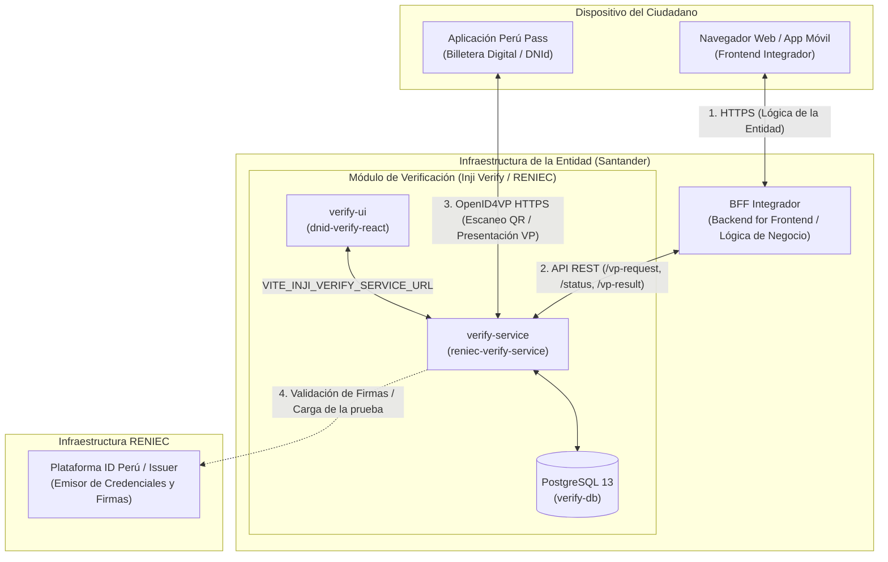
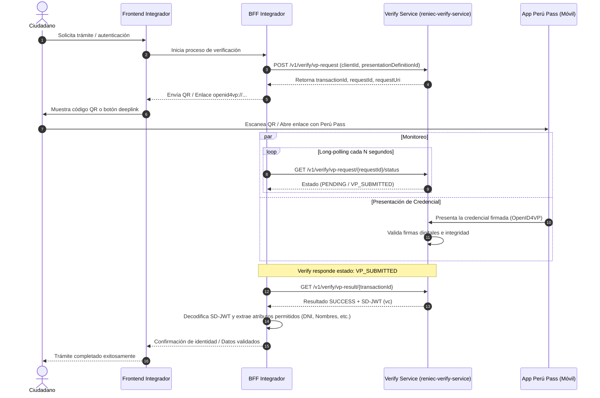

# Arquitectura de Verificación de DNI Digital (Perú Pass / ID Perú)

Basado en la documentación técnica oficial de RENIEC:
* *Guía técnica: Habilitar la API de verificación del DNId en infraestructura gestionada por una entidad externa (DT-DCSD/SDSCD-035)*
* *Guía técnica: Integración y consumo del servicio de verificación de credenciales a través de endpoints (DT-DCSD/SDSCD-036)*
* *Especificación técnica: Piloto de autenticación mediante arquitectura BFF basado en CIBA + PKCE (ID-Perú CIBA-v1.3)*

---

## 1. Diagrama de Componentes y Roles

---

## 2. Descripción de Componentes y Responsabilidades

| Componente | Administrado por | Rol / Responsabilidad |
| :--- | :--- | :--- |
| **Frontend Integrador** | Entidad (Santander) | Interfaz web o móvil con la que interactúa el usuario para solicitar el trámite o autenticación. |
| **BFF Integrador** | Entidad (Santander) | Backend For Frontend que resguarda credenciales y secretos, maneja sesiones, y orquesta las peticiones hacia el Verify Service. |
| **Verify Service (`reniec-verify-service`)** | Desplegado en la Entidad (Docker provisto por RENIEC) | Servicio backend encargado de: <ul><li>Generar la solicitud `OpenID4VP` (`/vp-request`).</li><li>Exponer el endpoint consultado por **Perú Pass**.</li><li>Verificar criptográficamente las credenciales (SD-JWT).</li><li>Exponer resultados validados (`/vp-result`).</li></ul> |
| **Verify UI (`dnid-verify-react`)** | Desplegado en la Entidad (Docker provisto por RENIEC) | Interfaz web provista por RENIEC para visualizar el código QR e interactuar directamente con `verify-service` mediante la variable `VITE_INJI_VERIFY_SERVICE_URL`. |
| **Perú Pass** | Ciudadano (App móvil) | Billetera digital en el teléfono del usuario donde reside el DNI Digital emitido por RENIEC. |

---

## 3. Diagrama de Secuencia del Flujo de Verificación

