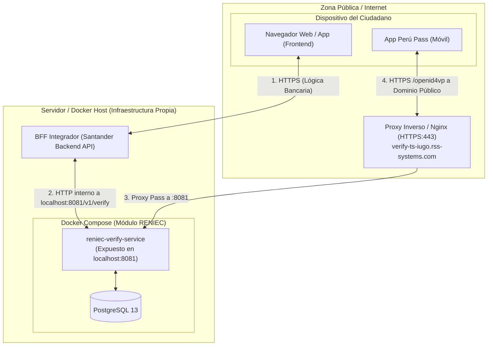
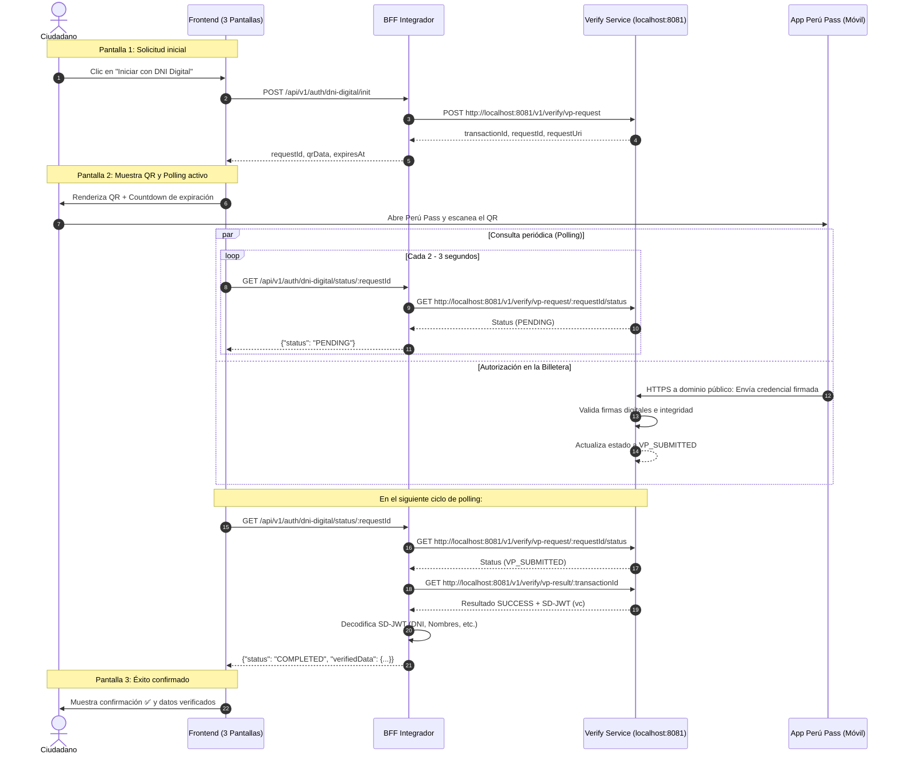

# Especificación Técnica y Funcional: Flujo de Verificación con DNI Digital (Perú Pass)

Basado en la documentación técnica oficial de RENIEC:
* *Guía técnica: Habilitar la API de verificación del DNId en infraestructura gestionada por una entidad externa (DT-DCSD/SDSCD-035)*
* *Guía técnica: Integración y consumo del servicio de verificación de credenciales a través de endpoints (DT-DCSD/SDSCD-036)*
* *Especificación técnica: Piloto de autenticación mediante arquitectura BFF basado en CIBA + PKCE (ID-Perú CIBA-v1.3)*

---

## 1. Flujo de Experiencia de Usuario (Frontend: 3 Pantallas)

El flujo de cara al ciudadano se compone de 3 pantallas consecutivas y reactivas:

```text
  [ PANTALLA 1 ]                       [ PANTALLA 2 ]                       [ PANTALLA 3 ]
+----------------------+             +----------------------+             +----------------------+
|  Santander           |             |  Escanea con         |             |  ¡Identidad          |
|                      |             |  Perú Pass           |             |  Verificada!         |
|  Verifica tu         |             |                      |             |                      |
|  identidad para      |  [Click]    |    [ CÓDIGO QR ]     |  [Autoriza] |        ✅            |
|  continuar           | ----------> |                      | ----------> |                      |
|                      |             |  Expira en: 02:45 min|             |  Bienvenido          |
|  [ Iniciar con ]     |             |                      |             |  Juan Carlos Pérez   |
|  [ DNI Digital ]     |             |  (Esperando escaneo..|             |  DNI: 47291038       |
+----------------------+             +----------------------+             +----------------------+
                                                ▲
                                                │ (Polling en segundo plano
                                                │  cada 2 a 3 segundos)
```

### 1.1. Pantalla 1: Solicitud de Verificación
* **Vista:** Pantalla informativa de la entidad (Santander) explicando la necesidad de verificar la identidad. Presenta un botón destacado: *"Iniciar con DNI Digital"*.
* **Acción:** El usuario hace clic en el botón.
* **Transición:** El frontend solicita al BFF la creación de la transacción. Si es exitosa, pasa inmediatamente a la Pantalla 2.

### 1.2. Pantalla 2: Presentación del QR y Espera de Validación
* **Vista:**
  * **En Escritorio (Desktop):** Muestra el Código QR generado a partir del `qrData` (esquema `openid4vp://...`) y un temporizador de cuenta regresiva (countdown) indicando el tiempo de expiración.
  * **En Celular (Mobile):** Además del QR, presenta el botón *"Abrir directamente en Perú Pass"* (deeplink).
* **Acción del usuario:** Abre la app móvil **Perú Pass**, escanea el QR y selecciona los campos requeridos para compartir (ej. DNI, nombres y apellidos), confirmando con su huella dactilar o PIN.
* **Comportamiento interno:** El frontend consulta en segundo plano cada 2 a 3 segundos al BFF el estado de la transacción (`polling`).

### 1.3. Pantalla 3: Confirmación de Identidad y Éxito
* **Vista:** Check verde animado, mensaje de felicitaciones y resumen de datos verificados:
  > *"¡Identidad Verificada Satisfactoriamente! Bienvenido, Juan Carlos Pérez (DNI: 47291038)"*
* **Transición:** Se detiene el polling de forma definitiva. Tras 1 o 2 segundos, el sistema redirige automáticamente al siguiente paso del proceso del negocio (apertura de cuenta, desembolso, etc.).

---

## 2. Topología de Red y Componentes Técnicos



> [!IMPORTANT]
> **Canales de Comunicación del Servicio de Verificación:**
> 1. **BFF hacia Verify Service (Interno):** El BFF consume el contenedor localmente a través de `http://localhost:8081/v1/verify`.
> 2. **Perú Pass hacia Verify Service (Público):** La app móvil requiere acceso vía **HTTPS** a través de un dominio público (`https://verify-ts-iugo.rss-systems.com/v1/verify`), ya que los dispositivos móviles no pueden conectarse a `localhost`.

---

## 3. Configuración de Entorno en el BFF (`.env`)

```bash
# Conexión directa del BFF al contenedor local
VERIFY_SERVICE_INTERNAL_URL=http://localhost:8081/v1/verify

# Dominio público expuesto para Perú Pass (usado en clientId y requestUri)
VERIFY_SERVICE_PUBLIC_URL=https://verify-ts-iugo.rss-systems.com/v1/verify
VERIFY_CLIENT_ID=did:web:verify-ts-iugo.rss-systems.com:v1:verify

# Identificador de perfil de datos de credenciales (provisto por RENIEC)
# Ejemplo: DNI Titular (vct: DniPeruanoCredential)
VERIFY_PRESENTATION_DEFINITION_ID=b2c3d4e5-f6a7-8901-bcde-f12345678901
```

---

## 4. Contratos de API (BFF Integrador ↔ Frontend)

### 4.1. Iniciar Solicitud de Verificación
* **Endpoint:** `POST /api/v1/auth/dni-digital/init`
* **Acceso:** Sesión del usuario en el Frontend
* **Flujo interno en el BFF:**
  1. Llama al contenedor local:
     ```bash
     POST http://localhost:8081/v1/verify/vp-request
     Content-Type: application/json

     {
       "clientId": "did:web:verify-ts-iugo.rss-systems.com:v1:verify",
       "presentationDefinitionId": "b2c3d4e5-f6a7-8901-bcde-f12345678901"
     }
     ```
  2. El contenedor devuelve:
     ```json
     {
       "transactionId": "txn_68851035-db49-4860-890f-4362df268a76",
       "requestId": "req_5ccc0964-6b08-4ecf-b869-93049fc95ce2",
       "expiresAt": 1783015304454,
       "requestUri": "https://verify-ts-iugo.rss-systems.com/v1/verify/vp-request/req_5ccc0964-6b08-4ecf-b869-93049fc95ce2"
     }
     ```
  3. El BFF guarda la relación `(sessionId, transactionId, requestId)` y arma el enlace `qrData`:
     ```text
     openid4vp://authorize?client_id=did%3Aweb%3A...&request_uri=https%3A%2F%2F...
     ```
* **Respuesta hacia el Frontend:**
  ```json
  {
    "requestId": "req_5ccc0964-6b08-4ecf-b869-93049fc95ce2",
    "qrData": "openid4vp://authorize?client_id=did%3Aweb%3Averify-ts-iugo.rss-systems.com%3Av1%3Averify&request_uri=https%3A%2F%2Fverify-ts-iugo.rss-systems.com%2Fv1%2Fverify%2Fvp-request%2Freq_5ccc0964-6b08-4ecf-b869-93049fc95ce2",
    "expiresAt": 1783015304454
  }
  ```

---

### 4.2. Polling de Estado y Recuperación de Datos
* **Endpoint:** `GET /api/v1/auth/dni-digital/status/:requestId`
* **Flujo interno en el BFF:**
  1. Consulta el estado en el contenedor local:
     ```bash
     GET http://localhost:8081/v1/verify/vp-request/{requestId}/status
     ```
  2. Si el estado es `PENDING`:
     * Responde al Frontend: `{"status": "PENDING"}`.
  3. Si el estado es `VP_SUBMITTED`:
     * Solicita el resultado final al contenedor local:
       ```bash
       GET http://localhost:8081/v1/verify/vp-result/{transactionId}
       ```
     * Valida que `vpResultStatus === "SUCCESS"`.
     * Extrae el campo `vc` (SD-JWT), decodifica los disclosures Base64URL y obtiene los datos del ciudadano.
     * Actualiza el estado de la sesión y genera los tokens bancarios correspondientes.
* **Respuesta hacia el Frontend:**
  ```json
  {
    "status": "COMPLETED",
    "verifiedData": {
      "dni": "47291038",
      "fullName": "JUAN CARLOS PEREZ RODRIGUEZ"
    }
  }
  ```

---

## 5. Diagrama de Secuencia Completo



---

## 6. Algoritmo de Extracción de Datos SD-JWT

El campo `vc` devuelto por el servicio es un token SD-JWT con segmentos delimitados por tildes `~`:

```text
<JWT_EMISOR>~<DISCLOSURE_1>~<DISCLOSURE_2>~...~<KB_JWT>
```

Cada *disclosure* intermedio se procesa de la siguiente manera:
1. Decodificar la cadena de Base64URL a texto UTF-8.
2. Parsear el resultado a un array JSON de 3 posiciones: `[sal, nombre_campo, valor]`.
3. Extraer los atributos correspondientes:
   * `CUI_DNI`
   * `PRENOMBRES`
   * `PRIMER_APELLIDO`
   * `SEGUNDO_APELLIDO`
